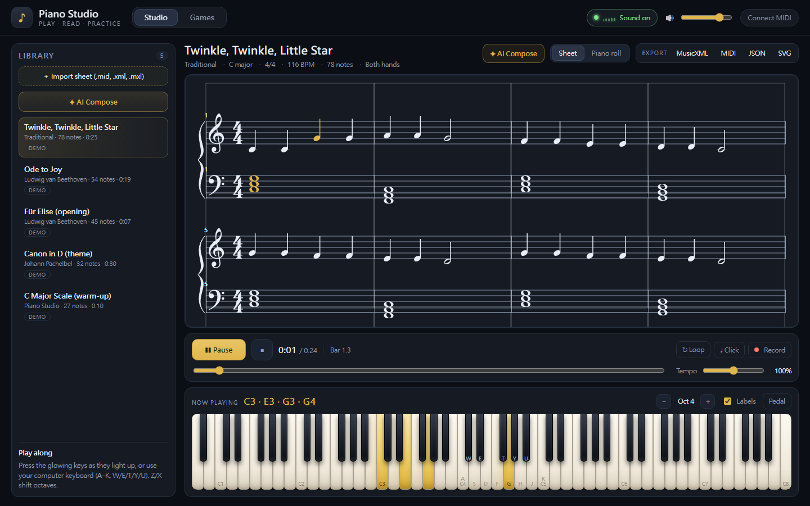
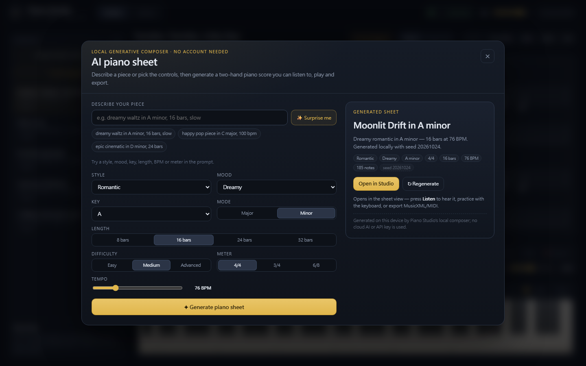

# Piano Studio

A browser piano studio: play an 88-key piano with synthesized sound, read along with real
sheet music, **generate new sheets with a local AI composer**, and practice with two games. It also
ships as a native **Android app** (Capacitor) — see [Android app](#android-app) below.


## Features

**Play**
- Full 88-key piano (A0–C8) with mouse, touch (multi-pointer) or computer keyboard.
- Realistic, velocity-sensitive Web Audio piano synthesis: inharmonic partials, per-note decay,
  hammer noise, stereo spread and reverb — no samples to download, works fully offline.
- Optional Web MIDI keyboard input (`Connect MIDI`) — play and see the keys light up.
- Live note readout shows exactly which keys are sounding, and both hands are colour-coded.
- Damper pedal toggle, octave shift, QWERTY labels on keys.

**Read**
- Grand-staff notation view rendered with VexFlow: key/time signatures, accidentals, beams, rests,
  ledger lines, two voices per staff, hands split across treble and bass.
- **Listen to the sheet** with the `▶ Listen` button: the full piece plays with piano sound while
  the sounding notes and keys light up. A live output meter next to `Sound on` shows the audio
  level, and the analyser confirms the signal is really reaching the speakers.
- Playback highlights the notes that are sounding and auto-scrolls to the current system.
- Click any measure to seek; click the falling-note view anywhere to seek too.
- Falling-note piano-roll view aligned to a live keyboard strip.
- Transport: Listen/pause, stop, seek, tempo 50–150 %, loop, metronome, bar.beat readout.



**AI composer**
- Generate a new two-hand piano sheet from a text prompt or controls: style (classical, romantic,
  pop, ambient, jazz, waltz), mood, key/mode, 8–32 bars, meter, difficulty and tempo.
- The local generative composer builds a chord progression, accompaniment pattern, motif-based
  melody, cadences and coda — no account, cloud AI or API key, works fully offline. Every piece is
  reproducible from its seed.
- Preview, regenerate, then open in Studio: AI sheets play with sound, can be practiced, recorded
  over, and exported as MusicXML/MIDI/JSON/SVG. They appear in the library with an **AI** badge.



**Import / export**
- Import `.mid`, `.midi`, `.musicxml`, `.xml`, `.mxl` (compressed MusicXML) and Piano Studio `.json`.
- Export the current score as **MusicXML** (sheet), **MIDI**, **JSON** (project) or **SVG** (sheet).
- Recording: hit Record, play on the piano, hit Record again — your take is quantized into a score
  that you can read, play back and export as sheet music.
- Demo library: Twinkle Twinkle, Ode to Joy, Für Elise, Canon in D, C major scale.
- Imported, recorded and AI-generated songs persist in the browser.

**Practice games**
- **Falling Notes** — notes fall toward the hit line; press the matching key. Perfect/great/good
  timing windows, combo, multiplier, accuracy, results rank, per-run length (short/full), tempo
  control, metronome and an assist mode that quietly plays the target notes.
- **Ear & Key Training** — 10 rounds, two modes: hear a note and find it, or find a named key.
  Streak, score, timing bonus, keyboard and on-screen input.


## Quick start

```bash
npm install
npm run dev        # http://localhost:5173
```

Production build and tests:

```bash
npm run build      # type-check + bundle to dist/
npm run preview    # serve the build (http://localhost:4173)
npm test           # Vitest suite
```

The app needs a modern browser with Web Audio (Chrome, Edge, Firefox, Safari). Audio starts after
the first click/keypress because of browser autoplay rules. Web MIDI is optional and depends on
browser support.

## Android app

The app is wrapped with [Capacitor](https://capacitorjs.com) and runs as a native Android app with
a dark splash screen, status-bar theming, hardware back navigation, screen wake-lock while
playing, and Android share-sheet exports. It includes the AI composer and the audible sheet
playback with live sound meter.

Signed release artifacts are included in `release/` (gitignored build output):

| Artifact | Size | Use |
| --- | --- | --- |
| `release/PianoStudio-1.0.1-release.apk` | 6.0 MiB | sideload / direct install |
| `release/PianoStudio-1.0.1-release.aab` | 5.8 MiB | Google Play Console upload |
| `release/SHA256SUMS.txt` | — | integrity checksums |

```text
Package      com.pianostudio.app
Version      1.0.1 (versionCode 2)
Min SDK      24 (Android 7.0+), target SDK 36
APK SHA-256  a5a8b9dd87bc27377bc42a8519525736865bb4ffd289cab1e629fb307ea4a51b
AAB SHA-256  d5f8c906d135a76d037185e01b3e1ff29c99c93130df403ebafdc69e95af06fd
Cert SHA-256 8D:39:AE:54:D9:F8:40:71:B8:3F:0A:6E:B7:9C:56:1C:10:19:F1:A0:8A:9D:FB:93:BF:83:61:AC:7B:12:7A:EA
```

Install the signed release over USB debugging, or copy the APK to the phone and open it (allow
“install unknown apps” for your file manager):

```bash
adb install -r release/PianoStudio-1.0.1-release.apk
```

If an older debug build is installed, uninstall it first — it uses a different signing key:

```bash
adb uninstall com.pianostudio.app
```

### Signed release builds

Release builds are signed with the RSA-2048 keystore at
`android/piano-studio-release.keystore` (alias `piano-studio`, certificate valid until 2054).
The credentials are read from `android/keystore.properties`; **both files are gitignored — back
them up**, because Android will only accept future updates signed with the same key.

`android/keystore.properties.example` is the template. The Gradle config automatically uses the
release keystore when `keystore.properties` exists; otherwise `assembleRelease` produces an
unsigned APK and the debug build is unaffected.

```bash
npm run android:release   # web build → cap sync → assembleRelease + bundleRelease
# APK: android/app/build/outputs/apk/release/app-release.apk
# AAB: android/app/build/outputs/bundle/release/app-release.aab

# verify the signature and checksum
apksigner verify --print-certs android/app/build/outputs/apk/release/app-release.apk
sha256sum release/PianoStudio-1.0.1-release.apk
```

On macOS/Linux, use `./gradlew assembleRelease bundleRelease` instead of the Windows
`gradlew.bat` wrapper used by the npm scripts.

Debug build (debug keystore, WebView debugging enabled):

```bash
npm run android:build     # → android/app/build/outputs/apk/debug/app-debug.apk
npm run android:open      # open the project in Android Studio
```

### Android behaviour

- **Back button**: closes a game → returns to the games page → returns to Studio → exits the app.
- **Exports** (MusicXML/MIDI/JSON/SVG): opened through the Android share sheet so you can save to
  Files, Drive, send by email, etc. Import uses the system file picker.
- **Audio** starts on the first tap (WebView autoplay rules) and pauses when the app is backgrounded.
  Sheet playback is audible and the output meter reacts, same as the web app.
- **AI composer** and the **Listen** button are available in the Android build too.
- **Rotation**: portrait is a sheet + keyboard layout; landscape is a compact sheet + full-width
  88-key keyboard practice view.

| Portrait | Landscape |
| --- | --- |
|  |  |

## Controls

| Action | Input |
| --- | --- |
| Play notes | Click/touch keys, or `A S D F G H J K` (white) and `W E T Y U` (black) |
| Octave shift | `Z` / `X`, or the − / + buttons |
| Listen / pause the sheet | `Space`, or the transport `▶ Listen` / `❚❚ Pause` button |
| Seek | Click a measure in the sheet, click the piano roll, or use the seek slider |
| AI compose | `✦ AI Compose` in the toolbar or library panel |
| Pedal / labels | Buttons above the keyboard |
| Games | `Games` tab → choose a game |

The QWERTY mapping is relative to the octave shown above the keyboard (`Oct 4` = C4). Game views
use the same mapping.

## Format notes / known limitations

- Internal scores are stored in quarter-note beats with a tempo map; MIDI ticks and MusicXML
  divisions are converted on import.
- The score model has a single global key signature; key changes later in an imported file are
  shown/exported with the first key signature.
- MusicXML has no velocity, so imported notes use a default velocity; MIDI/recorded velocities are
  preserved.
- MusicXML export writes sharps for black keys and snaps time-signature changes to bar lines.
- `.mxl` import expects a UTF-8 MusicXML score; `score-timewise` files are rejected with a clear
  message.
- SVG export renders the notation; MusicXML is the editable/interchange format.
- The **AI composer is a local generative composer** (rules, chord progressions, motif transforms
  and seeded randomness) rather than a cloud language model; it needs no account/API key and works
  offline. Different seeds regenerate different but equally deterministic pieces.

## Project layout

```
src/
  App.tsx                 app shell, library, transport wiring, import/export UI
  components/             keyboard, piano roll, transport, AI composer, sound meter, song library
  hooks/                  piano engine lifecycle, playback scheduler, QWERTY/MIDI input, recorder
  audio/                  Web Audio piano engine + synthesis + offline self-test
  music/                  score model, timing/tempo math, pitch helpers, demo songs, recording
  music/ai/               local generative composer + prompt parser
  music/formats/          MIDI + MusicXML parsers/writers, .mxl import, quantization, JSON
  sheet/                  VexFlow grand-staff renderer, layout, highlighting, SVG export
  game/                   falling-notes game, ear/key quiz, scoring and quiz logic
  styles.css              theme and layout
```

Playback is a look-ahead scheduler: notes are scheduled into the AudioContext ~0.9 s ahead while a
30 fps UI clock drives highlighting. All musical positions are beats; seconds are derived through
`src/music/timing.ts`, so tempo changes and seeking stay consistent.

## Verification

- **184 unit tests across 18 files** cover timing/tempo math, pitch/key signatures, score
  normalisation, recording quantization, MIDI/MusicXML round-trips, `.mxl` import, VexFlow layout
  helpers, audio voice/engine behaviour, AI composition/prompt parsing and game scoring/quiz logic.
- Live audio routing is covered by a regression test (voice output → master bus) and verified in
  headless Chrome with the master analyser: during sheet playback the analyser RMS rises to
  ~0.04–0.29, and the `Sound on` level meter animates. Sheet playback is therefore audible, not
  just scheduled.
- The AI composer was exercised in headless Chrome: the prompt “epic cinematic in D minor, 24 bars,
  92 bpm, advanced” produced a 300-note two-hand score, added it to the library with an AI badge and
  played it with the meter active — no console errors.
- The audio engine also has an offline self-test (`?audiotest` in the app) that renders individual
  notes and a chord through `OfflineAudioContext` and reports peak/RMS levels.
- The app was exercised end-to-end in headless Chrome: playback highlights keys and advances the
  clock, the falling-notes game scores key presses, the quiz advances, and every export format
  downloads and re-imports.
- The Android build was installed on an Android 14 emulator: audio output was confirmed through the
  Android audio stack (48 kHz stereo AAudio stream), playback highlighted 4 keys and advanced the
  transport, the falling-notes canvas rendered, MusicXML import via the system picker added the
  score (78 notes), the share sheet opened with the exported `.musicxml`, hardware Back navigated
  game → games page → Studio → exit, and both portrait and landscape layouts were checked.
- Signed release builds were verified with `apksigner` (APK Signature Scheme v2, RSA-2048); the
  1.0.0 build installed cleanly on a fresh Android 14 emulator, and 1.0.1 is built from the same
  tested web bundle with the AI composer and audio fix.

## Credits

Demo songs are traditional / public domain. Built with React, Vite, TypeScript, VexFlow and fflate.
